**02-【PRD】产品需求文档**

**星链 AI Lex — 产品需求文档（PRD）**

<table><tr><td>
层级 2 | 产品需求文档 核心问题：要做什么 — 把战略具体化为功能和优先级
</td></tr></table>

**一、文档信息**

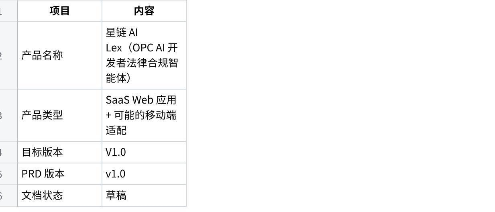

**点击图片可查看完整电子表格**

数据模型：三层记忆架构
星链 AI Lex 采用三层记忆架构，实现数据隔离与继承：
- Organization（组织级）：公司/团队维度，存储通用规则、模板、历史评估记录
- Workspace（产品级）：单个AI产品维度，存储该产品的风险评估、合规材料、时间线
- Session（会话级）：单次评估维度，存储当次问答、生成的报告、操作日志
三层架构确保不同团队、产品、评估间的数据隔离，同时支持知识复用。

**二、产品功能全景图**

<table><tr><td>
Plain Text ┌──────────────────────────────────────────────────────────────────┐ │                           星链 AI Lex                            │ ├────────────────┬──────────────────┬──────────────────────────────┤ │    PART A      │     PART B       │          PART C              │ │   设计期        │    开发期         │      上线合规模板中心         │ │   风险识别      │    合规评审       │                              │ ├────────────────┼──────────────────┼──────────────────────────────┤ │ · 产品概念输入  │ · 中国版评审      │ · 前台法律文本生成             │ │ · 引导式提问    │ · Agentic AI评审  │ · 监管备案模板生成             │ │ · 四维风险扫描  │ · 评审单生成      │ · Agentic AI操作协议          │ │ · 可溯源风险输出 │ · 整改清单        │ · 内部治理模板生成             │ │ · 风险简报生成  │ · 升级审批建议    │ · 动态模板引擎                │ │ · 设计建议输出  │                  │ · 合规文档打包                │ │ · 材料清单      │                  │ · 合规日历                   │ ├────────────────┴──────────────────┴──────────────────────────────┤ │                         公共能力层                                 │ ├──────────────┬──────────────┬──────────────┬─────────────────────┤ │ · 法规规则库  │ · 行业场景库  │ · 文档模板引擎 │ · 三级记忆分层       │ │ · 问卷/评分   │ · 留痕/证据库 │ · AuditLog    │ · Organization层    │ └──────────────┴──────────────┴──────────────┴─────────────────────┘
</td></tr></table>

**三、功能需求详述**

**F1：用户系统与工作空间**

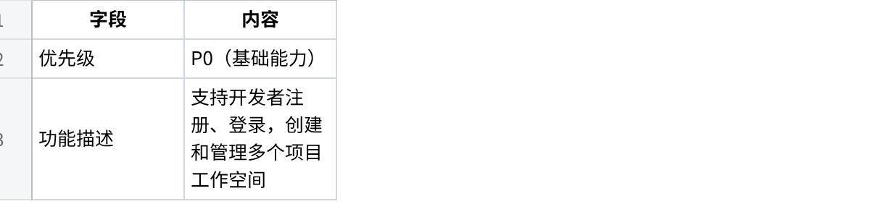

**点击图片可查看完整电子表格**

功能点：

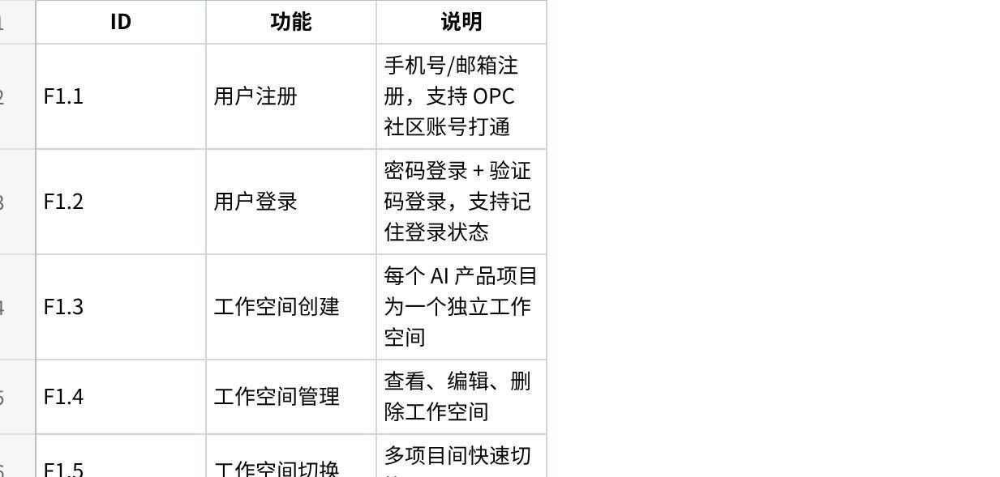

**点击图片可查看完整电子表格**

**F2：PART A — 设计期风险识别**

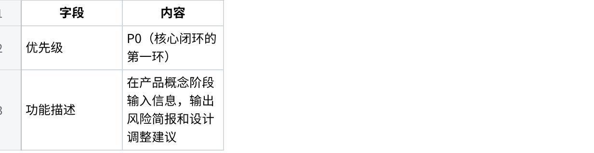

**点击图片可查看完整电子表格**

功能点：

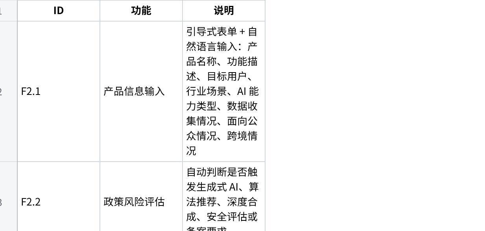

**点击图片可查看完整电子表格**

风险等级判定规则：

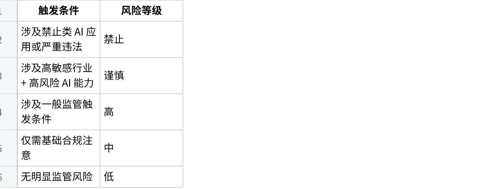

**点击图片可查看完整电子表格**

输入表单字段设计：

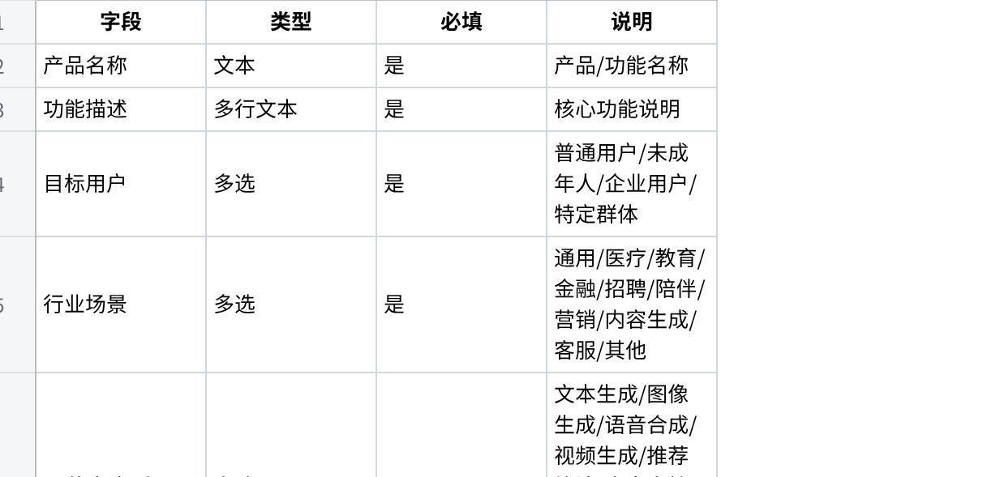

**点击图片可查看完整电子表格**

**F3：PART B — 开发期合规评审**

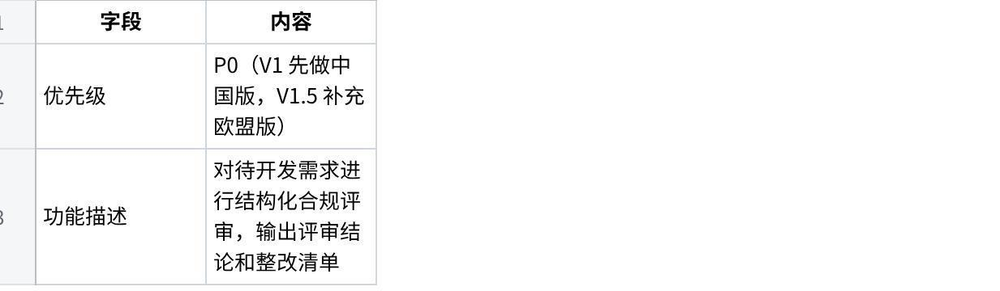

**点击图片可查看完整电子表格**

**F3.1 B1 — 中国版合规评审（P0）**

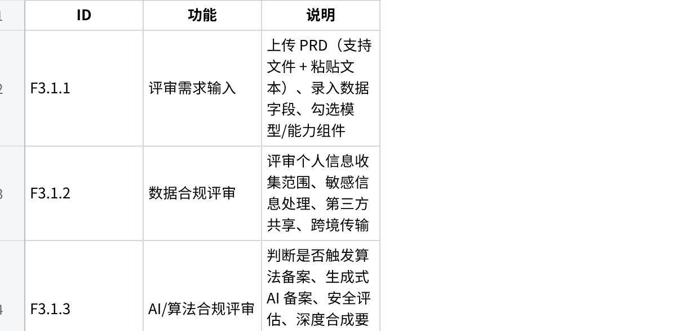

**点击图片可查看完整电子表格**

评审结论判定规则：

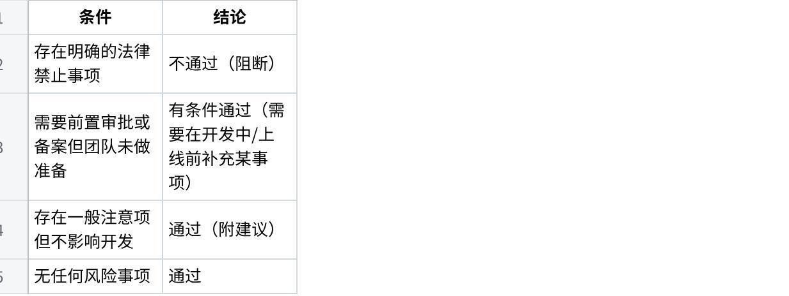

**点击图片可查看完整电子表格**

**F3.2 B2 — 欧盟版合规评审（P1，V1.5）**

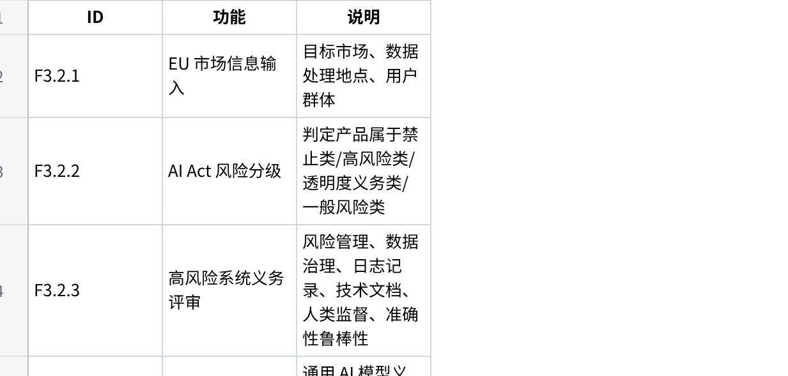

**点击图片可查看完整电子表格**

**F3.3 PART B 交互设计**

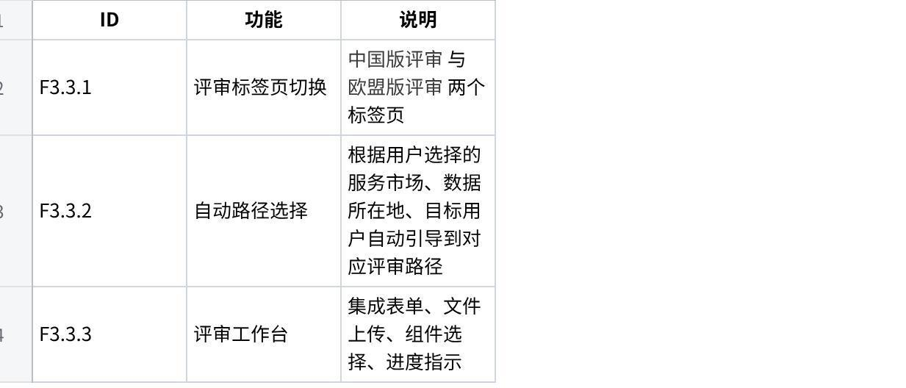

**点击图片可查看完整电子表格**

**F3.4 Agentic AI 专项评审维度（P0，Demo 重点展示）**

<table><tr><td>
当 AI 从"建议者"变成"执行者"——可以写文件、删文件、部署服务、操作数据库——合规框架必须从"工具提供者"升级为"自动化系统提供者"。
</td></tr></table>

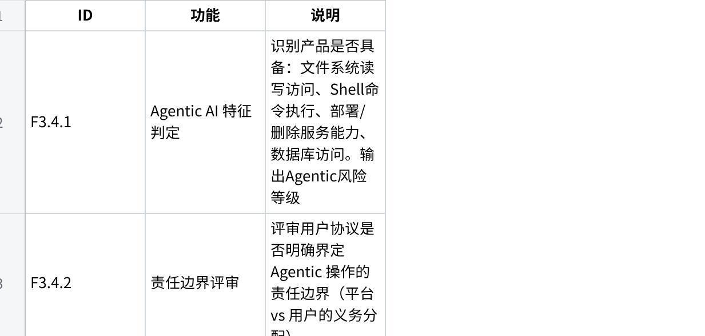

**点击图片可查看完整电子表格**

**F4：PART C — 上线合规模板中心**

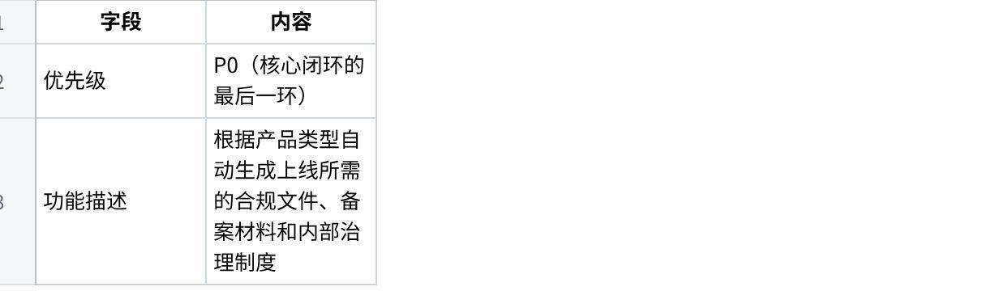

**点击图片可查看完整电子表格**

F4.0 C0 — ICP备案加速器（P0）
功能点：
- 模拟生成ICP备案所需全套材料（网站备案信息、负责人证件、服务协议等）
- 提供备案流程时间线预估与关键节点提醒
- 与合规日历联动，自动创建备案待办任务
核心价值：帮助开发者提前3-6个月准备备案材料，避免因材料不全导致的审核延误。

**F4.1 C1 — 前台法律文本模板（P0）**

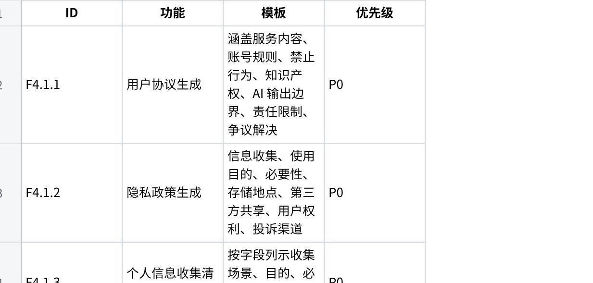

**点击图片可查看完整电子表格**

**F4.2 C2 — 监管/备案申报模板（P0）**

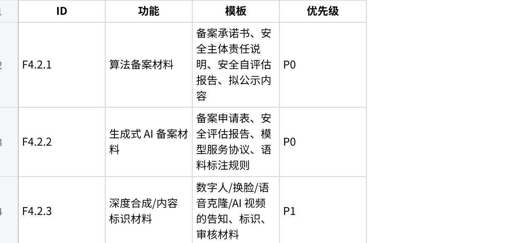

**点击图片可查看完整电子表格**

**F4.3 C3 — 内部治理与留档模板（P1）**

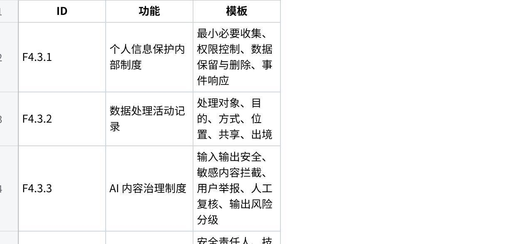

**点击图片可查看完整电子表格**

**F4.4 动态生成引擎（P0）**

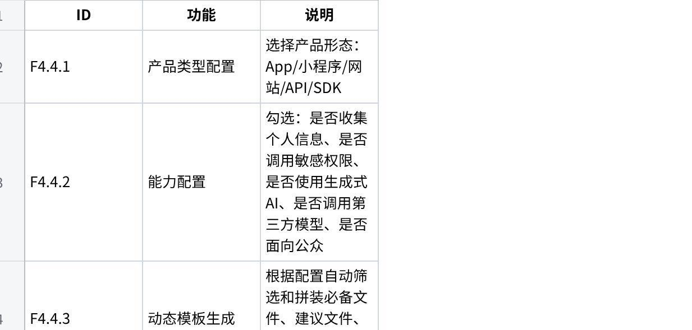

**点击图片可查看完整电子表格**

**F7：合规日历**

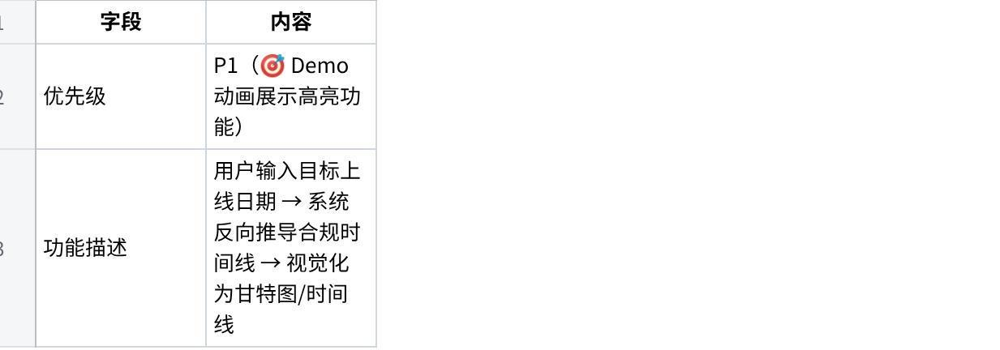

**点击图片可查看完整电子表格**

功能点：

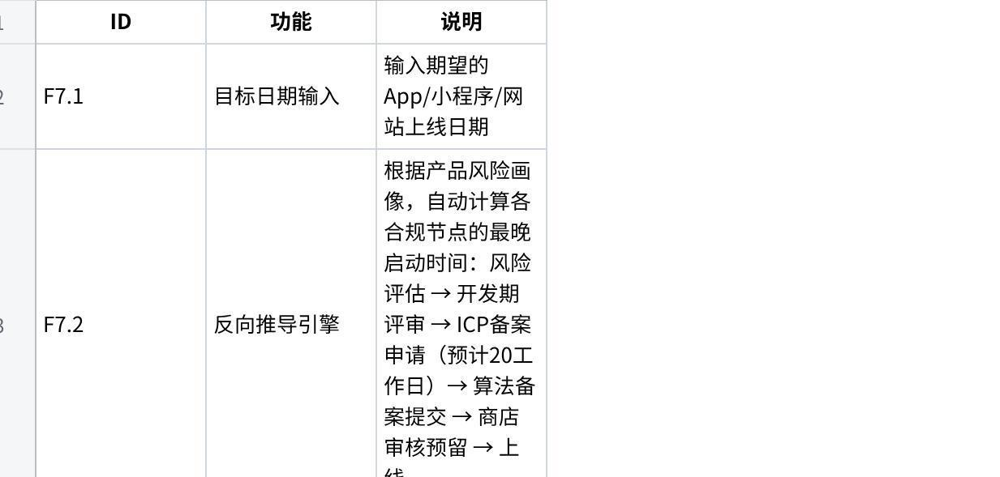

**点击图片可查看完整电子表格**

核心价值：独立模块，用户进入账号后即可查看合规日历。功能包括：提醒备案截止日期、法务更新推送、待办任务管理。把 Lex 从"事后用"变成"全程陪伴"——开发者从 Day 1 就能看到清晰的合规时间线，让合规与开发并行。

**F5：报告中心**

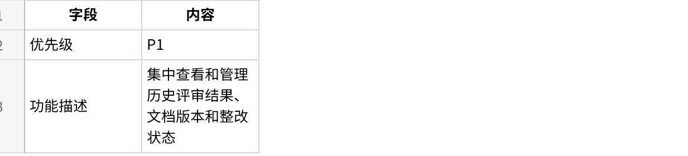

**点击图片可查看完整电子表格**

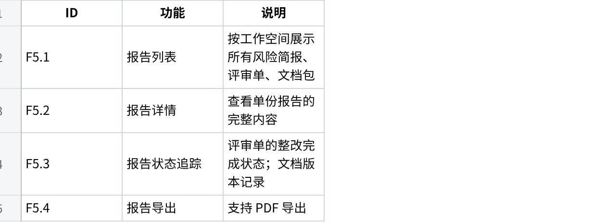

**点击图片可查看完整电子表格**

**F6：管理后台（园区版）**

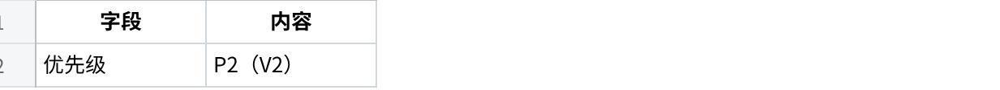

**点击图片可查看完整电子表格**

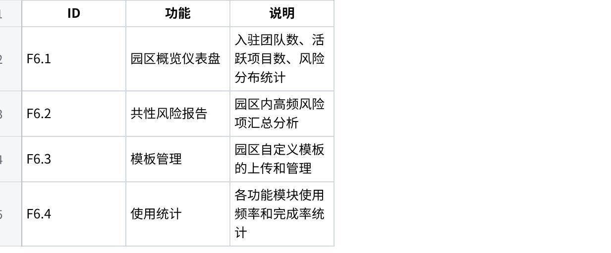

**点击图片可查看完整电子表格**

**四、用户流程**

**4.1 主流程：从评估到上线**

**4.2 快速路径**

已了解风险的开发者可直接进入 PART B 或 PART C，不强制依次走完 A→B→C。系统会给出"建议先完成 A/B"的提示，但不阻断。

四、操作日志与可溯源
为实现可溯源，系统记录所有用户操作日志：
- 每次风险评估的输入、输出、引用的规则条目
- 模板生成的操作记录与修改历史
- 后台管理操作（规则更新、模板发布等）
- 日志用于生成更改报告，支持监管问询回溯。

**五、非功能需求**

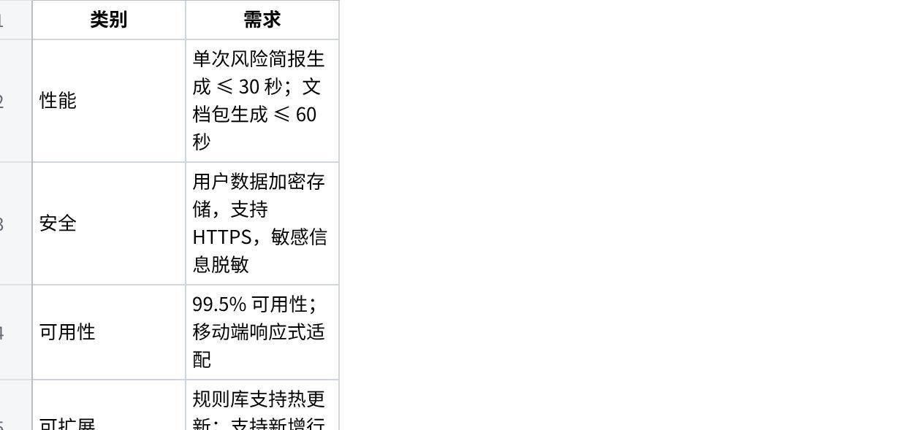

**点击图片可查看完整电子表格**

**六、功能优先级汇总**

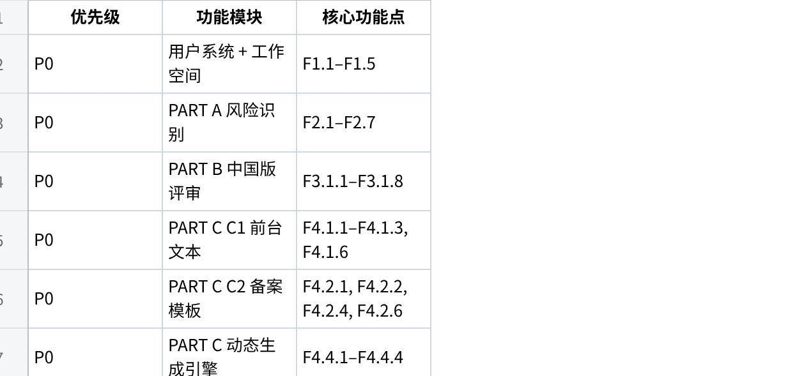

**点击图片可查看完整电子表格**

**七、Demo-MVP 优先级 — 比赛展示专用裁剪**

<table><tr><td>
比赛 Demo 目标：在 5 分钟内展示核心价值闭环，不需要完整产品功能。
</td></tr></table>

**7.1 Demo 范围：只做一条杀手级流程**

<table><tr><td>
Plain Text 免登录进入工作台     │     ▼ 自然语言描述产品（或填写表单）     │     ▼ AI 智能解析 → 30 秒风险简报（四维雷达图 + 风险等级 + 法规引用）     │     ▼ 一键生成合规文档包     │     ▼ 在线预览 + ZIP 下载
</td></tr></table>

**7.2 Demo 功能范围表**

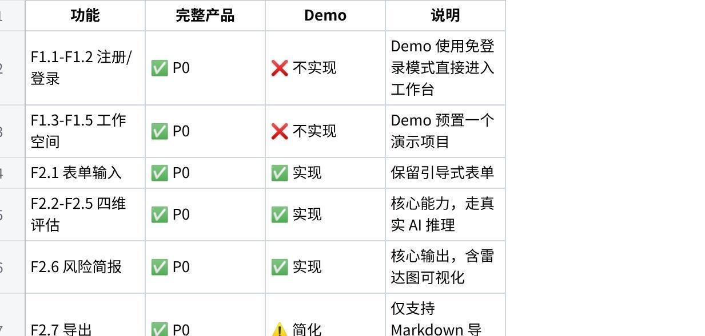

**点击图片可查看完整电子表格**

**7.3 Demo 技术简化策略**

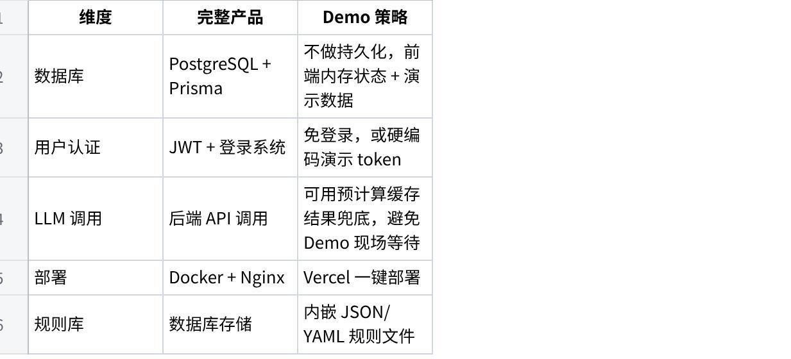

**点击图片可查看完整电子表格**

**7.4 Demo 专属用户故事**

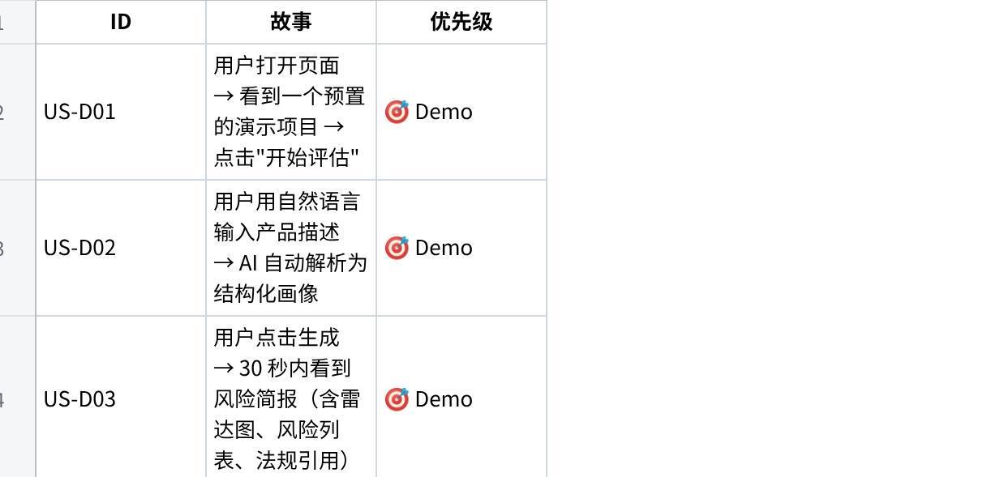

**点击图片可查看完整电子表格**

*本文档基于 opc\_ai\_compliance\_product\_framework.md 生成，属于产品文档层级 2/5。*